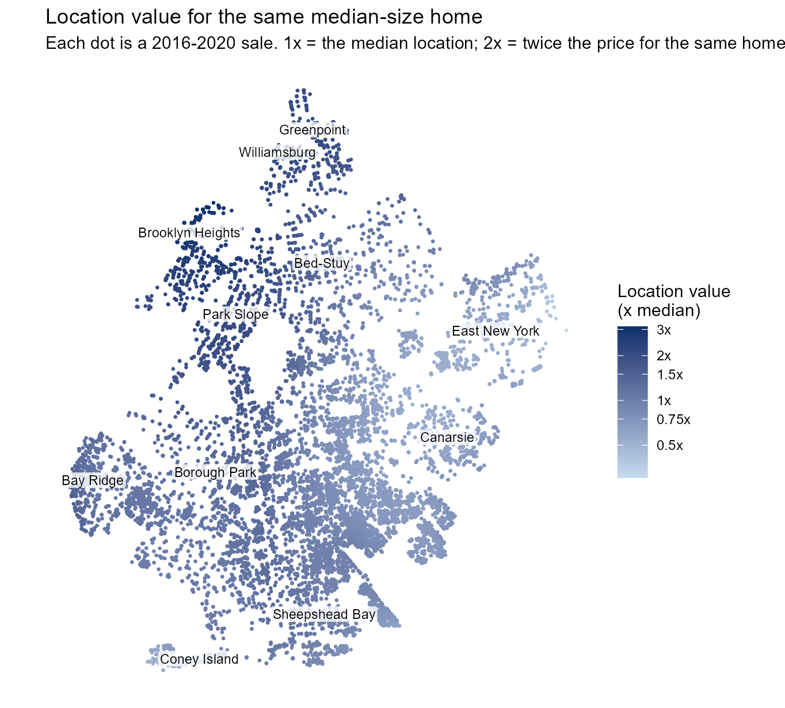

# Brooklyn Home Value Model (2016–2020)

An automated valuation model (AVM) for Brooklyn single-family houses and single-unit condos, built with linear regression on New York City's public sales records. The same model is then used to measure how much Brooklyn home prices changed from Q3 to Q4 2020, holding the home fixed.

> **Team project.** Each team member built a complete model independently; we then compared results and combined the strongest elements into one final model. This README describes that final model.
>
> This README describes the problem, the approach and the reasoning behind each major decision. The final model specification, code and coefficients are not included. **For model details, please contact Cole.**

---

## Results at a glance

| Requirement | Target | Result |
|---|---|---|
| Share of price differences explained (R²) | Over 60% | **71%** |
| Root-mean-square error, on the dollar scale | Under $450,000 | **$396,000** ($397,000 on held-out sales) |
| Model parameters, excluding the intercept | Under 40 | **37** |

- **Typical error:** half of homes sell within 16% of the model's estimate. The RMSE is much larger than the typical miss because it weighs large misses on expensive homes heavily.
- **Q3 → Q4 2020:** for the same home, Brooklyn prices rose about **6.3%** (95% CI +2.2% to +10.5%). A typical year's Q3 → Q4 change was about +0.7%, so the 2020 increase was well above normal seasonality.

---

## Location value across Brooklyn

*Estimated value of location alone for the same median-size home. Each dot is a 2016–2020 sale; darker is more valuable, and 1x is the median location. Brooklyn Heights is about 2.8x the median and East New York about 0.55x, so the same home is worth roughly five times as much in one as in the other. Location surface designed by a teammate.*

---

## Approach and key decisions

### 1. Cleaning five years of City data

The City publishes one file per year, and the files are not formatted consistently. We found title rows above the headers, line breaks inside column names, columns renamed between years, dollar signs and thousands separators, dashes used for zero, two date formats and padded text labels. We standardized every year to one schema, combined them, and added flag columns for unusual records instead of deleting anything at this stage. Filtering to single-unit residential sales, as the assignment specifies, left **20,821 sales**.

### 2. Deciding which sales to model

Every removal rule was set before any regression was run. **No sale was removed because the model priced it badly, and none was removed for being expensive.**

| Step | Removed | Reason |
|---|---|---|
| Record problems | 186 | Duplicates, conflicting prices for one home on one day, one price covering several properties, homes listed under 400 sq ft |
| Recorded at $0 | 6,752 | Not a sale: the City records a $0 transfer when no money changes hands |
| Recorded at $1 to $99,999 | 501 | Nominal-price deeds, far below any market price in Brooklyn |
| Outside the model's scope | 120 | The largest ~1% of homes (over 4,500 sq ft) and mansion-class properties |
| Below a price floor | 224 | The cheapest ~2% of houses and ~1% of condos |
| **Modeled** | **13,038** | 9,521 houses and 3,517 condos |

Why these rules:
- **We didn't trim the most expensive sales.** An AVM has to value expensive homes. Trimming the top of the price range would make the error metric look better than it is and bias the estimates. We limited scope by home size instead, which is known before a home sells.
- **We checked the price floor against deed records.** We matched removed sales to the City's deed records (ACRIS). 41% of the sales below the floor were family, partial-interest, estate, bank or foreclosure transfers, compared with 13% of a random sample of the sales we kept.

### 3. Representing location without putting price on both sides

Location is the biggest driver of price, but Brooklyn has about 60 neighborhoods, and one indicator for each would use most of the 40-parameter budget.

- **First approach, rejected:** We ranked neighborhoods into tiers by the prior year's price per square foot. After instructor feedback, we dropped it. Even lagged, a neighborhood price measure puts sale prices on both sides of the equation. Grouping neighborhoods by price has the same problem.
- **Final approach:** a smooth, price-free location surface built only from each home's coordinates (from NYC's PLUTO tax-lot data), plus distance-based measures. No location variable uses any sale price.
- **Alternatives compared**, on held-out error and parameter count:
  - the City's 18 community districts
  - simpler and more detailed versions of the surface
  - one indicator per neighborhood

  The final surface beat the districts by about $26,000 in held-out error. One indicator per neighborhood was about 3% more accurate but needed nearly twice the parameter limit.

### 4. Choosing predictors: accuracy first, fairness always

- **Every predictor had to improve held-out accuracy** in 10-fold cross-validation. Dropping any one of the final predictors raised the error.
- **The final model uses** location, home size, lot size, home type, building age and year of sale.
- **Tested and left out:**
  - **Subway access** added nothing once location was in the model.
  - **School test scores** added nothing.
  - **Neighborhood crime rates** improved accuracy by about 1%, but we left them out deliberately. Crime and school measures can act as proxies for a neighborhood's racial makeup, and pricing homes on them creates fair-housing risk.
- **No information from the future.** Outside data is either fixed geography or measured before 2016, so the model could run in production on the same inputs.

### 5. Measuring accuracy honestly

- **Log price, scored in dollars.** We modeled log price because errors grow roughly in proportion to price. Predictions were converted back to dollars with a retransformation (smearing) correction, and the error was scored on the raw dollar scale, as the assignment requires.
- **Held-out error.** We report 10-fold cross-validated RMSE alongside the in-sample figure. They are nearly identical, so the model is not memorizing its training data.
- **A plain-language error measure.** RMSE is dominated by the most expensive homes, so we also report the typical miss in percentage terms.
- **Robustness checks:**
  - influence diagnostics (no single sale moves the model)
  - a robust regression that down-weights unusual sales (nearly the same results)
  - residual checks for clustering by neighborhood and for seasonality

### 6. Isolating the same-home price change, Q3 → Q4 2020

- **Same model, finer time periods.** We reused the Part 1 model, splitting the 2020 time effect into periods so that Q3 and Q4 each get their own estimate, while staying under the parameter limit. The difference between them is the change in price for the same home.
- **Inference that respects the data.** Errors are correlated within neighborhoods, so confidence intervals use neighborhood-clustered standard errors, confirmed with a neighborhood-level bootstrap.
- **Mix vs. market.** Raw average prices rose about 8%, but Q4 also sold more new construction and more condos. About 1.7 points of the raw increase came from that mix of homes; the rest is the market.
- **Seasonality.** Prices normally run a little higher in Q4. Comparing 2020 with a typical year's Q3 → Q4 change shows that the 2020 increase was not ordinary seasonality.
- **Robust to the specification.** Eight alternative specifications gave increases of +4.4% to +8.0%. The +4.4% comes from a robust regression that down-weights large misses; every alternative with a confidence interval excluded zero.

---

## Limitations

- **The most expensive homes:** the top 10% of estimates run low, by about $150,000 on average.
- **Sharp neighborhood boundaries:** the location surface is smooth, so it blurs sharp price changes between adjacent areas, such as parts of Williamsburg.
- **Condos:** the City recorded condo square footage only for 2018 sales, so condo estimates rest on one year of data.
- **Single homes:** this is a market-level tool, not an appraisal. City records don't capture condition, renovations, layout or views.

---

## Data sources

- [NYC Department of Finance, annualized sales](https://www.nyc.gov/site/finance/property/property-annualized-sales-update.page): Brooklyn sales, 2016–2020
- [NYC PLUTO](https://data.cityofnewyork.us/d/64uk-42ks): tax-lot coordinates and building year built
- [NYC Parks properties](https://data.cityofnewyork.us/d/enfh-gkve): park locations
- [NYC ACRIS real property records](https://data.cityofnewyork.us/d/bnx9-e6tj): deed records, used only to validate the sample rules
- Tested and not used: [MTA subway stations](https://data.ny.gov/d/39hk-dx4f), [NYPD complaint data](https://data.cityofnewyork.us/d/qgea-i56i), [NYC ELA test results](https://data.cityofnewyork.us/d/iebs-5yhr)

**Tools:** R (tidyverse, sandwich, lmtest, sf, MASS), NYC Open Data (Socrata API)

---

## Contact

For the model specification, code or full results, please contact **Cole**.
